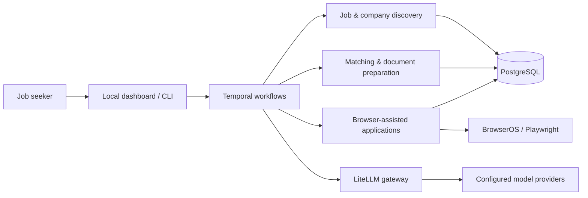

<p align="center">
  
</p>

<h1 align="center">ApplyPilot</h1>

<p align="center">
  <strong>An AI-powered, local-first workspace for the job-search journey.</strong><br />
  Discover opportunities, understand your fit, prepare tailored applications, and track what happens next.
</p>

<p align="center">
  
  
  
  
  
</p>

<p align="center">
  <a href="#what-it-does">Features</a> ·
  <a href="#how-it-fits-together">Architecture</a> ·
  <a href="#getting-started">Getting started</a> ·
  <a href="#project-layout">Codebase</a>
</p>

---

## Why ApplyPilot?

Finding the right role is more than clicking **Apply**. It involves searching fragmented job boards, checking fit and eligibility, tailoring documents, dealing with application forms, and following up across different channels.

ApplyPilot explores what it looks like to bring those tasks into **one operator-controlled workflow**. Its goal is to automate repetitive work while retaining the context, evidence, and visibility needed to make decisions.

This is an actively developed engineering project, **not a hosted SaaS product or a guarantee of job placement**. Integrations and automated actions depend on the services and accounts you configure.

## What it does

| Capability | Inside ApplyPilot |
| --- | --- |
| **Find opportunities** | Job discovery through ATS integrations (including Greenhouse, Lever, and Ashby), public sources, and company career pages. |
| **Research & evaluate** | Company signals, job enrichment, profile-aware matching, eligibility checks, and evidence-backed research. |
| **Prepare applications** | Resume tailoring, cover-letter generation, screening-question context, and PDF/DOCX document workflows. |
| **Assist with applications** | Browser-based application agents with configurable policies, retries, submission guards, and recorded outcomes. |
| **Track the journey** | Application history, inbox/feedback integrations, follow-up context, and operational diagnostics. |
| **Explore beyond listings** | Company watchlists, predictive research, referral preparation, and optional outreach workflows. |
| **Stay in control** | A private local dashboard for reviewing work, changing settings, monitoring workers, and pausing or resuming activity. |

These capabilities form a connected pipeline, but **not every job site or workflow is supported end to end**. Provider access, browser challenges, and external service policies can limit execution. A recorded attempt is not necessarily a confirmed submission.

## How it fits together



- **Backend:** Python 3.12, Typer, Temporal SDK, and PostgreSQL (including an embedded local option).
- **Frontend:** Python-served dashboard with Jinja/HTMX, Lit, and Web Awesome components.
- **Automation:** Playwright/browser integrations and agent-driven workflows.
- **AI layer:** LiteLLM for provider routing, with DSPy learning and recursive-context tooling.
- **Runtime:** Docker Compose services for the model gateway and Temporal; local workers handle application tasks.

Workflows, state, providers, and browser access are deliberately separate so that a source failure does not automatically become an application action.

## Getting started

### Requirements

- **Python 3.12** (managed by [uv](https://docs.astral.sh/uv/)).
- **Node.js 22+** and npm.
- **Docker** with Docker Compose.
- **Git**; on Windows, the workspace helper also uses the GitHub CLI (`gh`).
- Access to the separately maintained **LiteLLM gateway** repository for the full local stack.

> **Important: development checkout.** The gateway lives in a separate, currently private repository and is not bundled here. Fresh clones also need local environment configuration (including `docs/guides/.env` and the gateway's `gateway/.env`). Those files are intentionally not committed. As a result, a public clone cannot currently be started with `npm start` alone. See [workspace setup](docs/META_WORKSPACE.md) before attempting a full deployment.

### Run the complete local stack (configured collaborators)

```powershell
git clone https://github.com/adnahmed/ApplyPilot-main.git
cd ApplyPilot-main

# After GitHub authentication and access to the private gateway:
.\scripts\meta.ps1 git update

# Provision the private local gateway and docs/guides environment files.
# Then install dependencies, browsers, UI assets and start the services:
npm start
```

The `start` script runs the dependency setup, starts the supporting Docker services, initializes Temporal, and launches the dashboard and workers. The dashboard prints a **private access link**; the default local web port is `8765`. Do not publish that link or its token.

After initial setup:

```powershell
npm run start:quick    # Start infrastructure and application
npm run status         # Check infrastructure and workflow status
npm run pause          # Pause application activity
npm run resume         # Resume activity
npm run infra:stop     # Stop supporting infrastructure
```

Model keys and user-specific settings belong in your private `~/.applypilot/.env` (see [`.env.example`](.env.example)). Profile data, resumes, browser sessions, and application history must **never** be committed to Git.

### Explore the code without a configured deployment

You can review the app without connecting job boards or creating credentials:

```powershell
npm ci
npm run build:ui
```

The Python CLI entry point is `applypilot` (defined in [`pyproject.toml`](pyproject.toml)). Once the Python environment is prepared, `uv run applypilot --help` lists available commands. Some commands require initialized services.

## Project layout

| Path | Purpose |
| --- | --- |
| [`src/applypilot/discovery/`](src/applypilot/discovery/) | Job providers, feeds, normalization, and discovery planning. |
| [`src/applypilot/company_discovery/`](src/applypilot/company_discovery/) | Company targeting, sources, and predictive research. |
| [`src/applypilot/scoring/`](src/applypilot/scoring/) | Matching, resume tailoring, cover letters, and generated documents. |
| [`src/applypilot/apply/`](src/applypilot/apply/) | Application agents, browser control, policy, and evidence. |
| [`src/applypilot/orchestration/`](src/applypilot/orchestration/) | Temporal workflows, activities, schedules, and workers. |
| [`src/applypilot/web/`](src/applypilot/web/) | Dashboard server, UI templates, and static assets. |
| [`src/applypilot/tracking/`](src/applypilot/tracking/) | Application tracking and email/feedback processing. |
| [`docs/guides/`](docs/guides/) | Integration notes, infrastructure files, and technical guides. |

### Further reading

- [Company discovery and watchlists](docs/guides/company-discovery.md)
- [Predictive company research](docs/guides/job-swarm.md)
- [Jobseek crawler integration](docs/guides/jobseek.md)
- [Gateway workspace and private dependency](docs/META_WORKSPACE.md)
- [Dashboard UI components](src/applypilot/web/COMPONENTS.md)

## Responsible use & project status

ApplyPilot can work with sensitive applicant information and authenticated third-party services. Use only accounts you control or are authorized to use; respect each service's terms and rate limits. Review documents, answers, outreach, and submission settings before enabling unattended activity. Treat job matches, AI-generated text, and predictions as **decision support**, not verified facts.

The repository is published for technical exploration and ongoing development. It has a complex local runtime and is **not yet a turnkey, publicly reproducible release**. If you are evaluating the project, start with the architecture and individual subsystems above.

## License

The project metadata declares **AGPL-3.0-only** in [`pyproject.toml`](pyproject.toml). Bundled third-party components have their own copyright and license notices; see the relevant source directories and [dashboard notices](src/applypilot/web/static/THIRD_PARTY.md).
